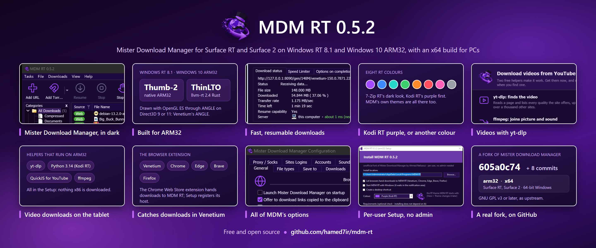

# MDM RT

An unofficial fork of [Mister Download Manager](https://github.com/anefzaoui/misterdownloadmanager) by Ahmed
Nefzaoui for **Windows RT 8.1** (Surface RT) and **Windows 10 ARM32** (Surface 2), also built for x64 Windows. It is
not made or supported by Ahmed Nefzaoui; Mister Download Manager's own README is [README-MDM.md](README-MDM.md).

- **Download**: [Releases](https://github.com/hamed7ir/mdm-rt/releases) - Setup for `arm32` or `x64` (per user,
  no admin; it also updates an installed MDM RT).
- ARM32 Thumb-2 build with [llvm-rt](https://github.com/hamed7ir)'s Rust and clang, ThinLTO and PGO (a profile
  from a real Surface 2 run, for MDM RT and its ffmpeg).
- Draws with OpenGL ES through ANGLE (Venetium's) on Direct3D 9 or 11, so the Tegra 3 and Tegra 4 can draw it.
- Video downloads work on ARM32: MDM RT brings yt-dlp (with Kodi RT's ARM32 Python), QuickJS for YouTube's
  challenges, and ffmpeg.
- The Chrome Web Store extension works in Venetium (and Chrome, Edge, Brave, Firefox): Setup registers the browser
  host, and "Add Mister Download Manager to your browser" lists Venetium first.
- RT themes: 7-Zip RT's dark look in Kodi RT's purple, or another accent colour; MDM's own themes are all there.
- Its own data folder and settings, so it runs beside an upstream Mister Download Manager.

The branch is Mister Download Manager's release commit plus one commit per change; the build scripts, patched
dependencies, helpers, installer, device kits and branding are in [mdm-rt/](mdm-rt/README.md)
([build recipe](mdm-rt/RECIPE.md)). Release tags follow Mister Download Manager's (`0.5.2`; a fix: `0.5.2.1`).

License: the same as Mister Download Manager - GNU GPL, version 3 or later ([LICENSE](LICENSE)). Mister Download
Manager is Copyright (C) 2026 Ahmed Nefzaoui.
